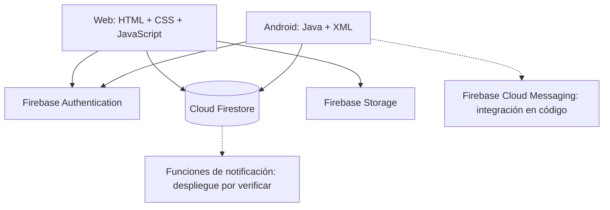

# AulaHub — Reservación de espacios académicos

**Sistema web y móvil para organizar solicitudes y disponibilidad de aulas, laboratorios y auditorios de la Facultad de Informática Culiacán (Universidad Autónoma de Sinaloa).**

🌐 **[Ver aplicación web](https://aulahub-1f738.web.app/)** · 📱 **[Código de Android](https://github.com/lizq237/AULAHUBMOVIL)** · 💻 **[Código web](https://github.com/lizq237/AULAHUB-web)**

> Proyecto académico colaborativo (2025). **Demo web funcional:** el 19 de noviembre de 2026 se comprobaron manualmente el acceso docente, la consulta de espacios, la creación de reservas, el acceso administrativo y la aprobación o rechazo de solicitudes. Requiere cuentas existentes en Firebase Authentication; **no ofrece registro público**. El acceso para evaluación se coordina de forma privada.

## ¿Qué problema resuelve?

AulaHub busca reducir la gestión manual de solicitudes de espacios académicos, permitiendo consultar aulas disponibles y solicitar horarios con un flujo de revisión administrativa.

El sistema cuenta con dos clientes que utilizan los servicios de Firebase:

- **Web:** interfaz para acceso, selección de espacios, calendario de solicitudes, historial y revisión administrativa.
- **Android:** aplicación nativa Java/XML para consultar espacios, reservar, ver solicitudes y recibir notificaciones.

### Espacios incluidos en la interfaz web

- Laboratorio de Cómputo A
- Laboratorio de Cómputo B
- Centro de Cómputo
- Auditorio FIC
- Laboratorio de Ciencia de Datos
- Laboratorio de Posgrado

Los nombres son categorías visibles en el código; la disponibilidad real depende de los registros existentes en Firestore.

## Para reclutadores: cómo evaluar AulaHub

**[🌐 Abrir la demostración web](https://aulahub-1f738.web.app/)** · [Código Android](https://github.com/lizq237/AULAHUBMOVIL)

El flujo **web** se comprobó manualmente con cuentas existentes de docente y administrador en Firebase el **19 de noviembre de 2026**:

| Comprobación | Resultado |
| --- | --- |
| Inicio de sesión como docente | ✅ Comprobado |
| Consulta de aulas y horarios | ✅ Comprobado |
| Creación de reserva | ✅ Comprobado |
| Inicio de sesión administrativo y vista de solicitudes | ✅ Comprobado |
| Aprobación o rechazo de reserva | ✅ Comprobado |

*Estas comprobaciones corresponden a pruebas manuales de la responsable del proyecto; no constituyen una auditoría de seguridad ni garantizan la disponibilidad permanente.*

### ¿Cómo obtener acceso a la demo?

La aplicación **no permite registro público**; ya existen cuentas habilitadas en Firebase Authentication. Para probar el recorrido completo, **solicita acceso temporal a la autora por [LinkedIn](https://www.linkedin.com/in/lizeth-quiroz-urias)**. Las credenciales se proporcionan por un canal privado cuando el acceso esté autorizado.

**No publicamos correos institucionales ni contraseñas en GitHub.** La cuenta administrativa tiene capacidad para modificar solicitudes, por lo que debe compartirse solo con personas de confianza y durante una evaluación controlada. Se recomienda usar datos ficticios y evitar modificaciones sobre reservas institucionales reales.

### Recorrido de evaluación con acceso autorizado

1. Abre la demo e inicia sesión con la **cuenta docente** proporcionada.
2. Entra a **Aulas**, selecciona un laboratorio y consulta el calendario y los horarios.
3. Elige materia, grupo, fecha y turno; registra una reserva de prueba.
4. Abre **Mis reservas** y observa su estado.
5. En una sesión separada, accede con la **cuenta administradora** autorizada.
6. Abre **Solicitudes** y aprueba o rechaza la petición.
7. Vuelve a la sesión docente y confirma la actualización del estado.

**Importante:** usa únicamente reservas y datos de demostración. El uso de las cuentas actuales no implica que el entorno sea aislado ni que tenga permisos auditados. Si no se concede acceso, el reclutador puede revisar el código y la pantalla pública de inicio de sesión.

## Stack tecnológico

| Componente | Tecnologías |
| --- | --- |
| Interfaz web | HTML5, CSS3, JavaScript (módulos ES) |
| Aplicación móvil | Android nativo, Java, XML, Android Studio |
| Autenticación | Firebase Authentication (correo y contraseña) |
| Base de datos | Cloud Firestore (NoSQL) |
| Archivos | Firebase Storage (fotos de perfil y recursos según la implementación) |
| Notificaciones | Documentos en Firestore; configuración de Firebase Cloud Messaging en Android |
| Hosting | Firebase Hosting |
| Gestión | Git, GitHub |

**Nota sobre Cloud Functions:** el repositorio web incluye un archivo `functions/index.js` de plantilla, sin funciones operativas exportadas. El repositorio Android contiene código de funciones de notificación, pero **no se verificó que estén desplegadas**. No se presenta Cloud Functions como un servicio de producción confirmado.

## Arquitectura



Los clientes se conectan a Firebase mediante sus SDK. Los documentos de Firestore modelan, entre otras cosas, `roles`, `profesores`, `reservas` y `notificaciones`. Los permisos y el aislamiento de datos deben protegerse con **reglas de seguridad de Firestore**, no solamente ocultando controles en la interfaz.

## Estructura del proyecto web

```text
AULAHUB-web/
├── public/
│   ├── index.html               # Acceso
│   ├── aulas.html               # Selección de espacios
│   ├── reserva.html              # Solicitud y calendario
│   ├── misReservas.html          # Historial
│   ├── solicitudes.html          # Revisión administrativa
│   ├── Firebase-Config.js       # Configuración del cliente Firebase
│   └── *.js / *.css             # Lógica y presentación
├── functions/                   # Plantilla de Cloud Functions
├── firebase.json                # Firebase Hosting
├── firestore.rules              # Reglas incluidas en repositorio (revisar)
└── README.md
```

## Instalación local (para desarrolladores)

### Opción 1: inspeccionar el código

```bash
git clone https://github.com/lizq237/AULAHUB-web.git
cd AULAHUB-web
```

La web es HTML/CSS/JavaScript sin un build con React. Puedes servir la carpeta `public` mediante un servidor estático, por ejemplo:

```bash
cd public
python -m http.server 5500
```

Abre `http://localhost:5500` para ver la interfaz. **Esto no crea una cuenta ni una base de datos local.** El código actual apunta al proyecto Firebase configurado y puede intentar usar datos remotos. Para probar reservas y escrituras, configura una instancia Firebase de pruebas y sus reglas antes de operar; no pruebes con información institucional real.

### Opción 2: Firebase Hosting

Para publicar tu propia copia necesitas permisos sobre un proyecto Firebase y Firebase CLI. Revisa las instrucciones oficiales: [Firebase Hosting](https://firebase.google.com/docs/hosting).

La configuración del proyecto utilizado en la demostración está identificada en `.firebaserc` y `public/Firebase-Config.js`. **La configuración del SDK web no equivale a credenciales administrativas.** Se requiere iniciar sesión en Firebase CLI con una cuenta de Google que tenga permisos.

## Gestión de acceso y Firebase

Se conservarán las **cuentas existentes** de docente y administrador que ya permiten comprobar el flujo web. No hace falta crear nuevas cuentas para actualizar esta documentación.

El ID de proyecto configurado en el código es `aulahub-1f738`. La persona con permisos sobre [Firebase Console](https://console.firebase.google.com/project/aulahub-1f738/overview) puede administrar los usuarios desde **Authentication → Users** y verificar las reglas vigentes desde **Firestore Database → Rules**.

Los perfiles y permisos de AulaHub también dependen de documentos de Firestore, por ejemplo `roles/{uid}` y `profesores/{uid}`, y de las materias y grupos registrados en `profesores/{uid}/salones`. La contraseña de un usuario **no se puede consultar desde Firebase Console**.

Para una evaluación externa, entrega los datos de acceso **en privado**, evita otorgar privilegios administrativos más allá de lo necesario y no publiques contraseñas en commits, incidencias, capturas ni README. Aunque se mantengan las cuentas existentes por ahora, conviene renovar las contraseñas compartidas anteriormente y comprobar los permisos antes de distribuir acceso a terceros.

### Aviso importante sobre Firestore

La versión de `firestore.rules` incluida en este repositorio contiene una regla temporal que deja de permitir solicitudes después del **3 de noviembre de 2025**:

```text
allow read, write: if request.time < timestamp.date(2025, 11, 3);
```

**La regla actualmente desplegada podría ser diferente y debe comprobarse en Firebase Console.** Si sigue vigente la regla expirada, las lecturas/escrituras del cliente fallarán. Si se reemplaza, debe hacerse con **reglas de mínimos privilegios** basadas en autenticación y roles, y probarlas antes de cualquier despliegue. **No copies ni publiques una regla que permita acceso global a cualquiera.**

## Estado de la demostración

- [x] Interfaz web publicada en Firebase Hosting.
- [x] Inicio de sesión docente comprobado manualmente.
- [x] Consulta de aulas y horarios comprobada manualmente.
- [x] Creación de reservas comprobada manualmente.
- [x] Inicio de sesión administrativo y solicitudes comprobados manualmente.
- [x] Aprobación y rechazo de reservas comprobados manualmente.
- [x] Repositorios web y Android disponibles para revisión de código.
- [ ] Revisar y probar las **reglas de Firestore actualmente desplegadas** para asegurar acceso por rol y usuario.
- [ ] Comprobar de nuevo el recorrido completo de la app Android.
- [ ] Añadir capturas o un video de demostración sin información privada.

**Conclusión:** el flujo web de ambos roles ha sido probado manualmente y puede mostrarse a reclutadores con acceso autorizado por un canal privado. Las pruebas manuales no demuestran por sí solas que el entorno esté seguro para acceso público.

## Equipo y créditos

AulaHub fue desarrollado como proyecto académico colaborativo para la Facultad de Informática Culiacán. **Lizeth Quiroz Urias** participó como líder de proyecto y en el desarrollo Android, colaborando también en la interfaz web. El README anterior del repositorio acreditaba a **Ricardo Ramos Puga**; se mantiene aquí ese reconocimiento. Consulta también el historial de Git para las contribuciones individuales.

---

*Proyecto académico demostrativo, no un sistema oficial de reservaciones institucionales en producción verificado.*
