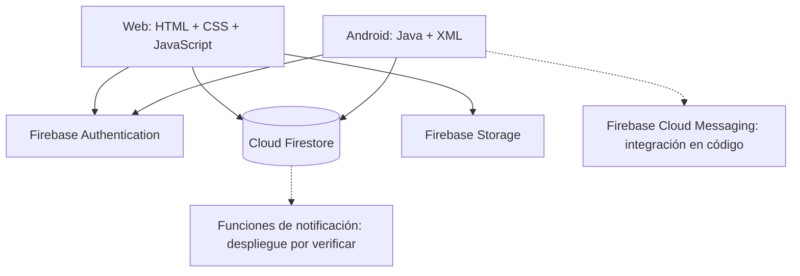

# AulaHub — Reservación de espacios académicos

**Sistema web y móvil para organizar solicitudes y disponibilidad de aulas, laboratorios y auditorios de la Facultad de Informática Culiacán (Universidad Autónoma de Sinaloa).**

🌐 **[Ver aplicación web](https://aulahub-1f738.web.app/)** · 📱 **[Código de Android](https://github.com/lizq237/AULAHUBMOVIL)** · 💻 **[Código web](https://github.com/lizq237/AULAHUB-web)**

> Proyecto académico colaborativo (2025). **La aplicación se encuentra publicada, pero requiere cuentas de usuario creadas previamente en Firebase Authentication. No ofrece registro público.** No se proporciona una cuenta de demostración ni se ha confirmado el acceso completo a los datos de producción.

## ¿Qué problema resuelve?

AulaHub busca reducir la gestión manual de solicitudes de espacios académicos, permitiendo consultar aulas disponibles y solicitar horarios con un flujo de revisión administrativa.

El sistema cuenta con dos clientes que utilizan los servicios de Firebase:

- **Web:** interfaz para acceso, selección de espacios, calendario de solicitudes, historial y revisión administrativa.
- **Android:** aplicación nativa Java/XML para consultar espacios, reservar, ver solicitudes y recibir notificaciones.

### Espacios incluidos en la interfaz web

- Laboratorio de Cómputo A
- Laboratorio de Cómputo B
- Centro de Cómputo
- Auditorio FIC
- Laboratorio de Ciencia de Datos
- Laboratorio de Posgrado

Los nombres son categorías visibles en el código; la disponibilidad real depende de los registros existentes en Firestore.

## Para reclutadores: cómo evaluar AulaHub

**Opción rápida (sin credenciales):**

1. Abre la [aplicación publicada](https://aulahub-1f738.web.app/) para ver la pantalla de acceso, el diseño y la presentación del producto.
2. Revisa el [código web](https://github.com/lizq237/AULAHUB-web) y el [repositorio Android](https://github.com/lizq237/AULAHUBMOVIL).
3. Las funciones internas (calendario, reservas e historial) **requieren una cuenta habilitada**. Actualmente no hay credenciales públicas de prueba.

**Con una cuenta de demostración autorizada y una base de prueba correctamente configurada:**

1. Inicia sesión como **docente**.
2. Selecciona un aula o laboratorio y revisa su calendario.
3. Selecciona un turno, materia, grupo, fecha y horario para solicitar una reservación.
4. Consulta el estado de la solicitud desde **Mis reservas**.
5. Utiliza una cuenta de **administrador** para aprobar o rechazar la solicitud.
6. Vuelve a la cuenta docente y comprueba el cambio de estado y las notificaciones registradas.

> Este recorrido describe las funciones implementadas en el código; **no se ha verificado de extremo a extremo con usuarios y reglas actualmente publicados**.

### ¿Por qué no hay usuario y contraseña en el README?

Las contraseñas de Firebase Authentication **no pueden recuperarse desde los archivos del repositorio**. Publicarlas en GitHub sería inapropiado. Para habilitar una demo se necesita acceso autorizado al proyecto Firebase y una cuenta ficticia, con permisos limitados y datos de prueba; nunca una cuenta real de docente ni de administrador.

## Stack tecnológico

| Componente | Tecnologías |
| --- | --- |
| Interfaz web | HTML5, CSS3, JavaScript (módulos ES) |
| Aplicación móvil | Android nativo, Java, XML, Android Studio |
| Autenticación | Firebase Authentication (correo y contraseña) |
| Base de datos | Cloud Firestore (NoSQL) |
| Archivos | Firebase Storage (fotos de perfil y recursos según la implementación) |
| Notificaciones | Documentos en Firestore; configuración de Firebase Cloud Messaging en Android |
| Hosting | Firebase Hosting |
| Gestión | Git, GitHub |

**Nota sobre Cloud Functions:** el repositorio web incluye un archivo `functions/index.js` de plantilla, sin funciones operativas exportadas. El repositorio Android contiene código de funciones de notificación, pero **no se verificó que estén desplegadas**. No se presenta Cloud Functions como un servicio de producción confirmado.

## Arquitectura



Los clientes se conectan a Firebase mediante sus SDK. Los documentos de Firestore modelan, entre otras cosas, `roles`, `profesores`, `reservas` y `notificaciones`. Los permisos y el aislamiento de datos deben protegerse con **reglas de seguridad de Firestore**, no solamente ocultando controles en la interfaz.

## Estructura del proyecto web

```text
AULAHUB-web/
├── public/
│   ├── index.html               # Acceso
│   ├── aulas.html               # Selección de espacios
│   ├── reserva.html              # Solicitud y calendario
│   ├── misReservas.html          # Historial
│   ├── solicitudes.html          # Revisión administrativa
│   ├── Firebase-Config.js       # Configuración del cliente Firebase
│   └── *.js / *.css             # Lógica y presentación
├── functions/                   # Plantilla de Cloud Functions
├── firebase.json                # Firebase Hosting
├── firestore.rules              # Reglas incluidas en repositorio (revisar)
└── README.md
```

## Instalación local (para desarrolladores)

### Opción 1: inspeccionar el código

```bash
git clone https://github.com/lizq237/AULAHUB-web.git
cd AULAHUB-web
```

La web es HTML/CSS/JavaScript sin un build con React. Puedes servir la carpeta `public` mediante un servidor estático, por ejemplo:

```bash
cd public
python -m http.server 5500
```

Abre `http://localhost:5500` para ver la interfaz. **Esto no crea una cuenta ni una base de datos local.** El código actual apunta al proyecto Firebase configurado y puede intentar usar datos remotos. Para probar reservas y escrituras, configura una instancia Firebase de pruebas y sus reglas antes de operar; no pruebes con información institucional real.

### Opción 2: Firebase Hosting

Para publicar tu propia copia necesitas permisos sobre un proyecto Firebase y Firebase CLI. Revisa las instrucciones oficiales: [Firebase Hosting](https://firebase.google.com/docs/hosting).

La configuración del proyecto utilizado en la demostración está identificada en `.firebaserc` y `public/Firebase-Config.js`. **La configuración del SDK web no equivale a credenciales administrativas.** Se requiere iniciar sesión en Firebase CLI con una cuenta de Google que tenga permisos.

## Recuperar acceso al proyecto y habilitar una demo

El proyecto Firebase que aparece en el código es **`aulahub-1f738`**.

- **Si olvidaste el correo o la contraseña de una cuenta de AulaHub:** un administrador autorizado puede ir a **Firebase Console → Authentication → Users**, encontrar al usuario y enviar un restablecimiento de contraseña, o crear una cuenta ficticia de prueba. Las contraseñas existentes no se muestran en la consola.
- **Si no recuerdas qué cuenta de Google administra Firebase:** intenta iniciar sesión con las cuentas de Google de los integrantes del equipo y abre [Firebase Console](https://console.firebase.google.com/project/aulahub-1f738/overview). Si el proyecto pertenece a otro compañero, pídele acceso mediante **Project settings → Users and permissions**. Si no puedes identificar al propietario, usa la [guía oficial de acceso a proyectos Firebase](https://firebase.google.com/support/faq).
- **Para pruebas de docentes/administradores:** no basta con crear el usuario en Authentication; la aplicación consulta además documentos en Firestore (por ejemplo `roles/{uid}` y `profesores/{uid}`) y, para el calendario, materias y grupos asociados al docente.

### Aviso importante sobre Firestore

La versión de `firestore.rules` incluida en este repositorio contiene una regla temporal que deja de permitir solicitudes después del **3 de noviembre de 2025**:

```text
allow read, write: if request.time < timestamp.date(2025, 11, 3);
```

**La regla actualmente desplegada podría ser diferente y debe comprobarse en Firebase Console.** Si sigue vigente la regla expirada, las lecturas/escrituras del cliente fallarán. Si se reemplaza, debe hacerse con **reglas de mínimos privilegios** basadas en autenticación y roles, y probarlas antes de cualquier despliegue. **No copies ni publiques una regla que permita acceso global a cualquiera.**

## Estado de la demostración

- [x] Interfaz web publicada en Firebase Hosting.
- [x] Repositorios web y Android disponibles para revisión de código.
- [ ] Cuenta ficticia de docente preparada y verificada.
- [ ] Cuenta ficticia de administrador con permisos limitados preparada y verificada.
- [ ] Reglas de Firestore desplegadas auditadas y probadas.
- [ ] Recorrido web/móvil probado con datos ficticios.
- [ ] Capturas o video de demostración añadidos.

Hasta que estos puntos estén validados, la URL pública sirve como **vista del acceso**, no como prueba garantizada del sistema completo.

## Equipo y créditos

AulaHub fue desarrollado como proyecto académico colaborativo para la Facultad de Informática Culiacán. **Lizeth Quiroz Urias** participó como líder de proyecto y en el desarrollo Android, colaborando también en la interfaz web. El README anterior del repositorio acreditaba a **Ricardo Ramos Puga**; se mantiene aquí ese reconocimiento. Consulta también el historial de Git para las contribuciones individuales.

---

*Proyecto académico demostrativo, no un sistema oficial de reservaciones institucionales en producción verificado.*
